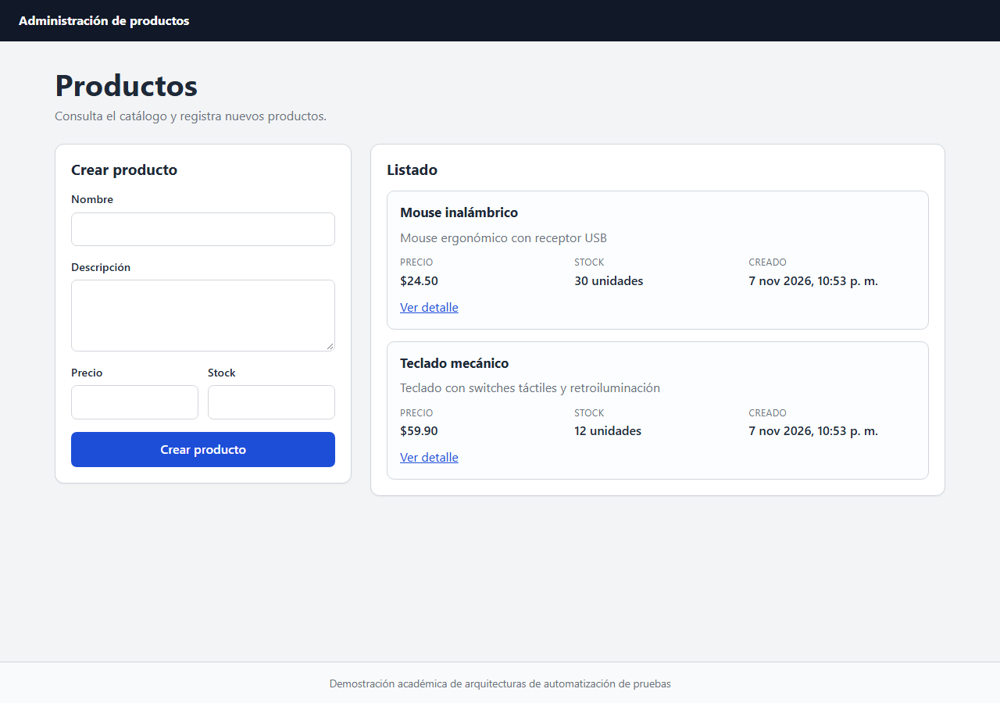
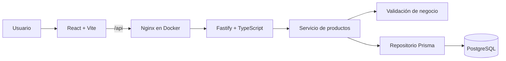

# Arquitecturas modernas para la automatización de pruebas

Repositorio académico para la materia **Pruebas de Software**. Contiene una
aplicación pequeña de administración de productos y dos suites de automatización
que prueban el mismo comportamiento:

1. `tests/bad/`: una automatización deliberadamente deficiente.
2. `tests/good/`: una automatización modular, aislada y mantenible.

El objetivo no es demostrar una aplicación compleja, sino comparar cómo la
arquitectura de las pruebas afecta su legibilidad, estabilidad y costo de
mantenimiento.

**Integrantes**

- Juán José Víquez Ríos
- Ángel Jesús Mena Coudin



## Objetivo

Demostrar, con código funcional y ejecutable, las diferencias entre:

- selectores posicionales y selectores semánticos;
- esperas fijas y esperas automáticas;
- datos hardcodeados y datos generados con aislamiento;
- pruebas dependientes entre sí y pruebas independientes;
- una suite monolítica y una separación por capas (páginas, flujos, fixtures,
  datos y cliente de API);
- pruebas solo de interfaz y una estrategia que también prueba la API y las
  reglas de negocio.

## Arquitectura de la aplicación



| Capa | Responsabilidad |
| --- | --- |
| Frontend (`apps/web`) | Componentes, páginas, formulario, mensajes de error y cliente HTTP. |
| Backend (`apps/api`) | Rutas REST, validación, reglas de negocio, acceso a datos y manejo de errores. |
| Base de datos | Persistencia real en PostgreSQL mediante Prisma. |
| Pruebas unitarias | Reglas de negocio puras y servicio sin base de datos. |
| Pruebas de API | Contrato HTTP y persistencia. |
| Pruebas E2E | Comportamiento visible para el usuario en Chromium. |

La API expone únicamente:

- `GET /api/products`
- `GET /api/products/:id`
- `POST /api/products`
- `GET /health` (infraestructura, usado por Docker)

### Validación en capas

El frontend valida la **forma** de los datos: campos presentes, precio numérico y
stock entero. El backend es la fuente de verdad de las **reglas de negocio**:
nombre obligatorio, precio mayor que cero y stock no negativo. Si el backend
rechaza una operación, el formulario muestra el mensaje y el error por campo.
Así se evita que el frontend sea la única capa que valida y se puede demostrar el
manejo de errores del servidor en una prueba E2E.

## Tecnologías

Versiones fijadas en `pnpm-lock.yaml`:

- Node.js 22
- React 19.3.1 + TypeScript 5.9.3
- Vite 7
- Fastify 5
- PostgreSQL 17
- Prisma ORM 6
- Playwright 1.65
- Vitest 4
- Docker Compose
- GitHub Actions
- pnpm 10

## Estructura del repositorio

```text
.
├── apps/
│   ├── api/
│   │   ├── prisma/
│   │   │   ├── migrations/
│   │   │   └── schema.prisma
│   │   ├── src/
│   │   │   ├── domain/          # Producto, reglas y errores
│   │   │   ├── repositories/    # Contrato y adaptador Prisma
│   │   │   ├── routes/          # Rutas REST
│   │   │   ├── services/        # Casos de uso
│   │   │   ├── app.ts           # Composición de Fastify
│   │   │   └── server.ts        # Arranque
│   │   └── tests/unit/          # Vitest
│   └── web/
│       ├── src/
│       │   ├── api/             # Cliente HTTP
│       │   ├── components/      # Formulario y tarjeta
│       │   ├── pages/           # Listado y detalle
│       │   └── types/
│       └── nginx.conf
├── tests/
│   ├── bad/                     # Suite deficiente intencional
│   └── good/
│       ├── api/                 # Pruebas de contrato HTTP
│       ├── data/                # Fábrica de datos y casos inválidos
│       ├── e2e/
│       │   ├── pages/           # Page Objects
│       │   ├── flows/           # Flow Model
│       │   ├── fixtures/        # Fixtures de UI
│       │   └── tests/           # Escenarios
│       └── support/             # Cliente API, fixtures base y limpieza
├── docs/
│   ├── architecture.md
│   ├── bad-vs-good.md
│   └── presentation-demo.md
├── scripts/clean-test-data.mjs
├── docker-compose.yml
└── .github/workflows/ci.yml
```

## Requisitos

- Node.js 22.12 o superior
- pnpm 10 (`corepack enable`)
- Docker con Docker Compose

## Cómo levantar el sistema

### Opción A: todo con Docker (recomendada para la demostración)

```bash
docker compose up --build
```

Servicios:

| Servicio | URL |
| --- | --- |
| Frontend | http://localhost:8080 |
| API | http://localhost:3000/api/products |
| PostgreSQL | `localhost:55432` |

La API aplica las migraciones automáticamente al arrancar. Para detener:

```bash
docker compose down
```

Para borrar también los datos:

```bash
docker compose down -v
```

### Opción B: desarrollo local

```bash
corepack enable
pnpm install
cp apps/api/.env.example apps/api/.env
docker compose up -d db
pnpm db:generate
pnpm db:deploy
pnpm dev
```

En Windows PowerShell, el equivalente de `cp` es:

```powershell
Copy-Item apps/api/.env.example apps/api/.env
```

- Frontend de desarrollo: http://127.0.0.1:5173
- API: http://127.0.0.1:3000
- Vite redirige `/api` hacia el backend, por lo que el navegador usa el mismo
  origen y no se necesita CORS.

> Si ya hay un servicio escuchando en los puertos 3000, 5173, 55432 u 8080,
> deténlo antes de levantar otra instancia.

## Pruebas

Todas las suites de UI y API necesitan PostgreSQL levantado y migrado:

```bash
docker compose up -d db
pnpm db:deploy
```

Playwright inicia automáticamente el backend y, cuando corresponde, Vite. Si ya
están corriendo, los reutiliza en local.

### Por nivel

```bash
# Unitarias (no requieren base de datos)
pnpm test:unit

# API: contrato HTTP y persistencia
pnpm test:api

# E2E moderna: listado, creación, detalle y validación
pnpm test:e2e

# Suite moderna completa (API + E2E)
pnpm test:good

# Todo lo verificable: lint, tipos, unitarias y suite buena
pnpm test
```

### Mala automatización

```bash
pnpm test:bad
```

La suite mala deja el producto `Producto Demo` en la base para evidenciar la
falta de limpieza. Para eliminar los datos de prueba:

```bash
# PowerShell
$env:CONFIRM_TEST_DB="1"; pnpm db:clean:test

# Bash
CONFIRM_TEST_DB=1 pnpm db:clean:test
```

El script de limpieza se bloquea si `NODE_ENV=production`, si no se confirma con
`CONFIRM_TEST_DB=1` o si el host de la base no es local (`localhost`,
`127.0.0.1`, `::1` o el servicio `db` de Docker).

### Contra la aplicación en Docker

Las suites usan por defecto servidores de desarrollo. Para probar el frontend
compilado y servido por Nginx:

```bash
docker compose up -d --build
pnpm test:api:docker
pnpm test:e2e:docker
pnpm test:bad:docker
```

## Reportes

Cada suite genera un reporte HTML y artefactos en caso de fallo:

| Suite | Reporte | Artefactos |
| --- | --- | --- |
| API | `playwright-report/good-api` | `test-results/good-api` |
| E2E | `playwright-report/good-e2e` | `test-results/good-e2e` |
| Mala | `playwright-report/bad` | `test-results/bad` |

```bash
pnpm report:good:api
pnpm report:good:e2e
pnpm report:bad
```

Los fallos conservan screenshot, video y trace de Playwright. Un trace se puede
abrir con:

```bash
pnpm exec playwright show-trace test-results/good-e2e/<carpeta>/trace.zip
```

## Bad vs. good

| Aspecto | `tests/bad` | `tests/good` |
| --- | --- | --- |
| Selectores | `input.nth(0)`, `.product-card` | Roles y etiquetas accesibles |
| Sincronización | `waitForTimeout` | Auto-waiting de Playwright |
| Datos | Hardcodeados | Fábrica con identificadores únicos |
| Preparación | Ninguna; depende de otra prueba | API o interfaz con helpers explícitos |
| Limpieza | No existe | Fixture automática + limpieza de restos |
| Estructura | Un archivo con pasos repetidos | POM, Flow Model, fixtures y datos |
| Assertions | Texto parcial del `body` | Valores concretos y errores por campo |
| Ejecución aislada | El segundo test falla solo | Cualquier test corre solo |
| Cobertura | Solo UI | Unitarias + API + E2E |

La comparación detallada está en [docs/bad-vs-good.md](docs/bad-vs-good.md).

## Docker y CI/CD

Docker Compose levanta PostgreSQL, la API y el frontend compilado:

- `apps/api/Dockerfile`: instala dependencias, genera Prisma, compila TypeScript
  y aplica migraciones al iniciar.
- `apps/web/Dockerfile`: compila Vite y sirve los archivos con Nginx.
- Nginx redirige `/api` al contenedor de la API y sirve `index.html` para las
  rutas del cliente.

GitHub Actions ejecuta trabajos independientes para:

1. lint, type checking, build y pruebas unitarias;
2. pruebas de API;
3. pruebas E2E;
4. demostración de la suite mala;
5. build de las imágenes Docker.

Los reportes se publican como artefactos incluso cuando una prueba falla. La
pipeline falla si falla cualquier paso. No se almacenan secretos: las
credenciales de PostgreSQL son exclusivamente locales/de CI.

## Resultados reales de la última ejecución local

Medidos el 2026-11-08 en Windows 11, Node 22.19.0, pnpm 10.16.1, Playwright
1.65.0 y Chromium 158, con PostgreSQL 17 en Docker. Son tiempos de una sola
ejecución, no un benchmark.

| Verificación | Resultado | Duración reportada |
| --- | --- | --- |
| `pnpm lint` | Correcto | — |
| `pnpm typecheck` | Correcto | — |
| `pnpm build` | Correcto | — |
| `pnpm test:unit` | 13/13 | 1.12 s |
| `pnpm test:api` | 8/8 | 5.3 s |
| `pnpm test:e2e` (Vite) | 5/5 | 25.4 s |
| `pnpm test:e2e:docker` (Nginx) | 5/5 | 14.3 s |
| `pnpm test:bad` | 3/3 | 22.1 s |
| `docker compose build` | Correcto | — |

Los tiempos varían entre corridas: la suite E2E buena también se midió en 18.2 s.
La suite mala contiene 11.5 segundos de esperas fijas y solo 3 pruebas; la buena
cubre 5 escenarios. No se usa la velocidad como argumento principal ni como
benchmark: la diferencia relevante es que la suite buena se puede ejecutar por
partes, en paralelo y sin depender de estado previo.

No se ejecutó GitHub Actions desde este entorno local; el workflow está definido
y sus pasos se validaron por separado. La primera ejecución en GitHub será la
validación real de la pipeline.

## Limitaciones conocidas

- No incluye autenticación, usuarios, carrito ni pagos: quedan fuera del alcance.
- No hay endpoints de actualización o eliminación; la limpieza de datos de prueba
  se hace con un helper de base de datos protegido, no con la API.
- La lista no tiene paginación; el volumen de la demostración no lo requiere.
- El precio se muestra con formato `$` y dos decimales; no hay configuración
  multi-moneda.
- Las pruebas E2E se ejecutan solo en Chromium de escritorio.
- La suite mala es intencionalmente deficiente y contamina la base; usa
  `pnpm db:clean:test` para limpiarla.
- Las imágenes Docker usan credenciales locales de demostración y no están
  preparadas para producción.
- El proyecto no afirma que la pipeline de GitHub haya pasado: se validó
  localmente cada comando y el workflow queda listo para su primera ejecución.

## Documentación adicional

- [Arquitectura de la aplicación y de las pruebas](docs/architecture.md)
- [Comparación entre la mala y la buena automatización](docs/bad-vs-good.md)
- [Guion de demostración de 5 minutos](docs/presentation-demo.md)
