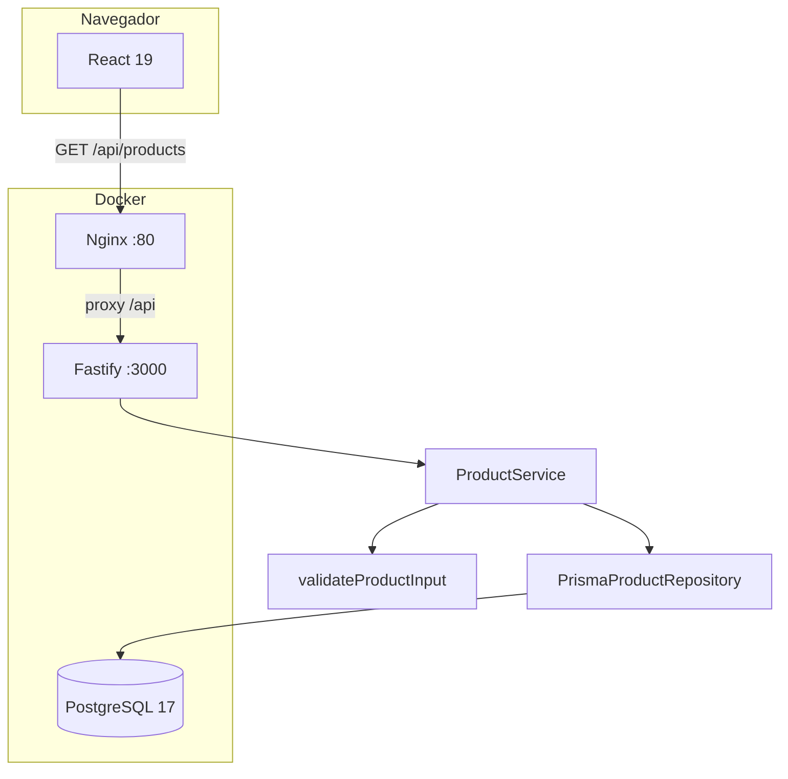

# Arquitectura

Este documento describe la aplicación y, sobre todo, la arquitectura de las
pruebas. La aplicación es intencionalmente pequeña: su función es ofrecer un
comportamiento de negocio realista sobre el cual comparar dos formas de
automatizar.

## 1. Vista general



En desarrollo, Vite cumple el papel de Nginx: sirve el frontend y redirige
`/api` a `http://localhost:3000`. En Docker, Nginx sirve el `dist` compilado y
hace el mismo proxy. El navegador siempre usa rutas relativas, así que no hay
CORS ni URLs de API codificadas en el frontend.

## 2. Capas del backend

### Dominio

`apps/api/src/domain/product.ts`

- Define `Product`, `NewProduct` y los errores de campo.
- Contiene `validateProductInput`, una función pura que:
  - normaliza nombre y descripción;
  - exige nombre no vacío;
  - exige precio numérico, finito y mayor que cero;
  - redondea el precio a dos decimales;
  - exige stock entero y no negativo;
  - acumula todos los errores para devolverlos juntos.
- No conoce HTTP, Fastify ni Prisma. Esto permite probarla con Vitest sin base de
  datos.

`apps/api/src/domain/errors.ts` define `ValidationError` y `NotFoundError`, que
la capa HTTP traduce a 400 y 404.

### Servicio

`apps/api/src/services/product-service.ts`

Orquesta los casos de uso:

- listar;
- obtener por id, lanzando `NotFoundError` si no existe;
- crear, validando antes de llamar al repositorio.

El servicio depende de la interfaz `ProductRepository`, no de Prisma. En las
pruebas unitarias se reemplaza por un repositorio falso y se comprueba que una
entrada inválida no llega a persistirse.

### Repositorio

`apps/api/src/repositories/product-repository.ts` define el contrato.
`prisma-product-repository.ts` es el adaptador:

- consulta con orden descendente por `createdAt`;
- convierte `Decimal` de Prisma a `number` para el dominio;
- crea registros.

### HTTP

`apps/api/src/routes/products.ts` expone los tres endpoints. No contiene reglas
de negocio; solo traduce entrada/salida y códigos HTTP.

`apps/api/src/app.ts` compone Fastify, registra las rutas, define el manejador
central de errores y el 404. El formato de error es estable:

```json
{
  "error": {
    "code": "VALIDATION_ERROR",
    "message": "Revisa los datos del producto.",
    "fields": {
      "price": "El precio debe ser mayor que cero."
    }
  }
}
```

`GET /health` existe para el healthcheck de Docker, no como funcionalidad de
negocio.

## 3. Contrato de la API

| Método | Ruta | Éxito | Errores relevantes |
| --- | --- | --- | --- |
| GET | `/api/products` | 200, arreglo de productos | 500 |
| GET | `/api/products/:id` | 200, producto | 404, 500 |
| POST | `/api/products` | 201, producto creado | 400 con `fields`, 500 |

Un producto serializado:

```json
{
  "id": "cmw7...",
  "name": "Teclado mecánico",
  "description": "Teclado con switches táctiles",
  "price": 59.9,
  "stock": 12,
  "createdAt": "2026-11-08T04:39:22.155Z"
}
```

La validación acepta `description` ausente o vacía. El precio se redondea a dos
decimales antes de persistirse en `Decimal(10,2)`.

## 4. Base de datos

`apps/api/prisma/schema.prisma`:

```prisma
model Product {
  id          String   @id @default(cuid())
  name        String
  description String   @default("")
  price       Decimal  @db.Decimal(10, 2)
  stock       Int
  createdAt   DateTime @default(now())

  @@index([createdAt])
}
```

La migración inicial está versionada en
`apps/api/prisma/migrations/20261108043716_init/`. Docker ejecuta
`prisma migrate deploy` al arrancar la API; en local se usa `pnpm db:deploy` o
`pnpm db:migrate` cuando se modifica el esquema.

## 5. Capas del frontend

- `src/api/products.ts`: cliente `fetch` tipado, errores `ApiError` con campos.
- `src/components/ProductForm.tsx`: estado del formulario, validación de forma y
  presentación de errores del backend.
- `src/components/ProductCard.tsx`: tarjeta semántica de producto.
- `src/pages/ProductsPage.tsx`: carga del listado, estado vacío, error de carga y
  creación.
- `src/pages/ProductDetailPage.tsx`: detalle por id, 404 y enlace de vuelta.
- `src/App.tsx`: rutas con React Router.

### Validación en dos niveles

| Nivel | Qué valida | Por qué |
| --- | --- | --- |
| Navegador | Campos presentes, precio numérico, stock entero | Retroalimentación inmediata de forma |
| Backend | Nombre obligatorio, precio > 0, stock >= 0 | Integridad del negocio, independiente del cliente |

Las reglas de negocio se prueban en unitarias y API. Las E2E comprueban que un
precio cero o negativo muestra el mensaje del backend junto al campo, lo que
demuestra que el frontend no es la única capa que valida.

## 6. Arquitectura de la suite buena

```text
tests/good/
├── api/
│   ├── playwright.config.ts
│   └── products.spec.ts
├── data/
│   ├── product-factory.ts
│   └── invalid-products.ts
├── e2e/
│   ├── pages/          # Page Objects
│   ├── flows/          # Flow Model
│   ├── fixtures/       # Extiende las fixtures base con páginas y flujo
│   ├── tests/          # Escenarios legibles
│   └── playwright.config.ts
└── support/
    ├── products-api.ts # Cliente de API reutilizable
    ├── fixtures.ts     # productFactory + productsApi + limpieza
    ├── database.ts     # Limpieza segura con pg
    ├── global-setup.ts # Elimina restos antiguos
    └── types.ts        # Contrato externo de la API
```

### Page Object Model

`ProductsPage` encapsula:

- navegación;
- localización semántica del formulario y sus campos;
- llenado y envío;
- tarjeta de producto por nombre;
- apertura del detalle.

`ProductDetailPage` encapsula el encabezado, la sección de detalles y el enlace
de vuelta.

Los Page Objects no contienen datos de prueba ni conocen el orden de los inputs.
Usan `getByLabel`, `getByRole` y nombres accesibles.

### Flow Model

`CreateProductFlow` expresa el caso de uso "crear producto":

```ts
await productsPage.fillProduct(product);
await productsPage.submit();
await expect(productsPage.successMessage).toBeVisible();
```

El test decide **qué** producto y qué verificar; el flujo concentra **cómo** se
crea. Si mañana cambia el formulario, se ajusta el Page Object; si cambia el
proceso (por ejemplo, un paso de confirmación), se ajusta el flujo. Los tests no
se tocan.

### Fixtures

`tests/good/support/fixtures.ts` extiende `test` de Playwright con:

- `productsApi`: cliente HTTP apuntando a `API_BASE_URL`.
- `productFactory`: crea datos con un prefijo único por test y, al terminar,
  elimina todo lo que tenga ese prefijo.

`tests/good/e2e/fixtures/test.ts` agrega:

- `productsPage`;
- `productDetailPage`;
- `createProductFlow`.

Ventajas:

- no hay `beforeEach` repetido;
- la limpieza ocurre aunque el test falle;
- cada test recibe dependencias explícitas;
- el test declara solo lo que usa.

### Data-Driven Testing

`invalid-products.ts` centraliza los casos inválidos:

- precio negativo;
- precio cero;
- stock negativo;
- nombre vacío.

Las pruebas de API recorren todos con `for...of`; las E2E recorren los que deben
llegar al backend. Agregar un caso es agregar un objeto, no copiar un test.

### Cliente de API

`ProductsApi` se usa en dos lugares:

- pruebas de API, para verificar el contrato;
- preparación de datos E2E, para crear un producto sin pasar por la interfaz.

Esto evita duplicar `fetch`, serialización y comprobación de status.

### Aislamiento y limpieza

- Cada test usa un prefijo `qa-good-<uuid>`.
- La fixture elimina por prefijo al finalizar.
- `globalSetup` elimina restos con más de una hora de antigüedad.
- La limpieza se bloquea si `NODE_ENV=production` o si el host no es local.
- Las pruebas de API no dependen de un listado vacío: verifican que su producto
  esté incluido, no que sea el único.

## 7. Niveles de prueba

| Nivel | Herramienta | Qué cubre | Qué no cubre |
| --- | --- | --- | --- |
| Unitaria | Vitest | Reglas puras y orquestación del servicio | HTTP, Prisma, navegador |
| API | Playwright APIRequestContext | Contrato, validación, persistencia | Interfaz, accesibilidad visual |
| E2E | Playwright + Chromium | Formulario, listado, detalle, errores | Reglas internas aisladas |

No se duplican todas las validaciones en todos los niveles. Las reglas se prueban
en unitarias; el contrato y la persistencia en API; la integración visible en E2E.

## 8. CI/CD

`.github/workflows/ci.yml` define cinco trabajos:

1. `quality`: instalación, generación de Prisma, lint, tipos, build y unitarias.
2. `api-tests`: PostgreSQL de servicio, migraciones y pruebas de API.
3. `e2e-tests`: PostgreSQL, Chromium, pruebas E2E y artefactos.
4. `bad-suite`: ejecuta la suite mala como demostración y publica su reporte.
5. `docker`: valida que las imágenes se construyan.

Cada trabajo falla si falla su comando. Los reportes se suben con
`actions/upload-artifact` incluso cuando hay fallos.

Ventajas de CI/CD en este contexto:

- la suite se ejecuta en un entorno limpio y reproducible;
- se detectan dependencias ocultas del estado local;
- los reportes y traces quedan disponibles para diagnosticar;
- el merge se puede bloquear si la calidad o las pruebas fallan;
- la mala arquitectura se vuelve evidente cuando falla de forma intermitente o
  depende del orden.

## 9. Decisiones y límites

- **Fastify sin CORS**: el frontend y la API comparten origen mediante proxy.
- **Prisma con PostgreSQL**: persistencia real, migraciones versionadas.
- **Sin endpoints de borrado**: la limpieza de pruebas usa un helper de base de
  datos con guardas, no una API administrativa.
- **Sin autenticación**: fuera del alcance de la demostración.
- **Playwright para API y E2E**: un solo runner, un solo reporte, menos
  dependencias.
- **Sin paginación**: el conjunto de datos es pequeño y la demostración se
  concentra en la arquitectura de pruebas.
- **Chromium únicamente**: suficiente para la comparación académica; agregar
  Firefox/WebKit es configuración, no rediseño.
